# LOOP CRM Reports: User Manual

The Reports page answers three questions about your sales team:

1. **How many leads did we get, and where did they come from?**
2. **What happened to each lead: which statuses did it pass through, not just where it is now?**
3. **How fast does each employee respond, counting only their working hours?**

You choose any period, down to the exact minute, and every number, chart and export follows it.

> **Screenshots** in this manual come from a live company (a clinic, so employees are labelled "Doctor"). The Arabic interface has the same layout, mirrored right to left. See [section 12](#12-arabic-and-right-to-left).

## Contents

1. [Who can open Reports](#1-who-can-open-reports)
2. [Quick start](#2-quick-start)
3. [Choosing the period](#3-choosing-the-period)
4. [Filters](#4-filters)
5. [The eight tabs](#5-the-eight-tabs)
6. [Drilling into the leads behind a number](#6-drilling-into-the-leads-behind-a-number)
7. [Response time explained](#7-response-time-explained)
8. [One-time setup: business hours and target](#8-one-time-setup-business-hours-and-target)
9. [Exporting and printing](#9-exporting-and-printing)
10. [How the numbers are calculated](#10-how-the-numbers-are-calculated)
11. [Reading history correctly](#11-reading-history-correctly)
12. [Arabic and right to left](#12-arabic-and-right-to-left)
13. [Troubleshooting](#13-troubleshooting)
14. [For administrators](#14-for-administrators)

---

## 1. Who can open Reports

| Person | Access |
|---|---|
| Company owner | Full access |
| Supervisor | Only with the **Reports** permission (Settings → Supervisors) |
| Employees, doctors, reception, data entry, call center | No access. The page is hidden and the data is refused by the server. |

Reports always cover your **whole company**, whatever your own role.

## 2. Quick start

1. Open **Reports** in the sidebar.
2. Pick a period at the top (for example **Last 30 Days**).
3. Click a tab to look at the area you care about.
4. Click any underlined number or bar to see the actual leads behind it.
5. Use **Export Excel** or **Print / PDF** to share it.

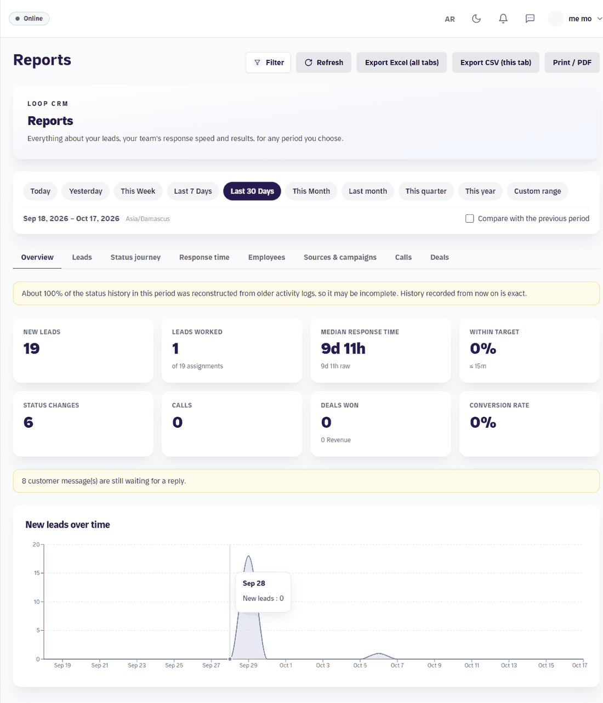

The page has four parts, top to bottom:

- **Action buttons:** Filter, Refresh, Export Excel, Export CSV, Print / PDF.
- **Period picker:** presets, a custom range and the compare switch.
- **Tabs:** Overview, Leads, Status journey, Response time, Employees, Sources & campaigns, Calls, Deals.
- **The report itself:** tiles, charts and tables for the current tab.

The tab, period and compare setting are saved in the page address. Copy the link to send exactly this view to a colleague who has access.

**Reports remembers how you left it.** Next time you open Reports (from the sidebar, after a refresh, or on another day) it returns to your last tab, period (including a custom range), compare setting and filters, plus the Work-hours / Elapsed toggle on the Response time tab and the sort column on the Employees tab. This is stored in your own browser, separately for each person, so it never affects anyone else. A link that spells out a tab or period always wins, so shared links open exactly as sent. To start fresh, choose a preset, press **Reset** in Filters, or clear your browser's site data.

## 3. Choosing the period

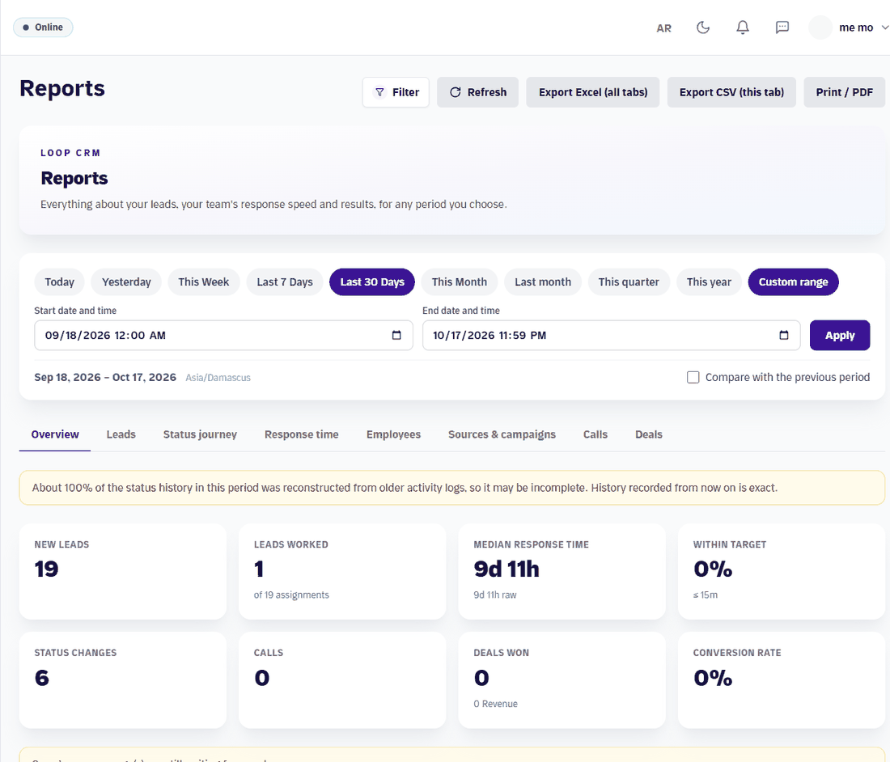

**Presets:** Today, Yesterday, This Week (starting Monday), Last 7 Days, Last 30 Days, This Month, Last month, This quarter, This year. A preset stays current: "Last 30 Days" always means the 30 days ending today.

**Custom range:** choose **Custom range**, then set a **start date and time** and an **end date and time**, and press **Apply**.

- The end must be after the start. The longest period is 2 years. Otherwise a message explains the problem.
- The end moment is **not included**, so back-to-back periods never count the same lead twice.
- Example: `29 Sep 00:00` to `29 Sep 12:30` shows exactly the morning of 29 September.

**Time zone:** all times are in your **company's time zone**, shown next to the dates (for example `Asia/Damascus`), not your computer's. A report looks the same no matter where the viewer is. The time zone is set by the owner under Settings.

**Compare with the previous period:** tick the box and the **Overview** tab shows each tile's change against the period of the same length just before. A green arrow means better, red means worse. For response time, *lower is better*.

## 4. Filters

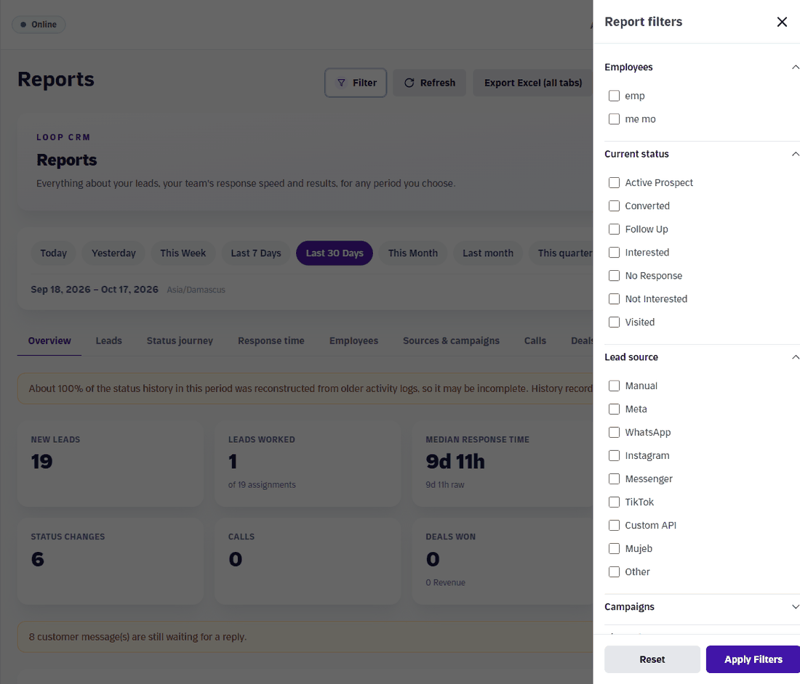

Press **Filter** to narrow every tab at once:

- **Employees:** only work handled by the people you tick.
- **Current status:** only leads that are in these statuses now.
- **Lead source:** Manual, Meta, WhatsApp, Instagram, Messenger, TikTok, Custom API, Mujeb, Other.
- **Campaigns, Channels, Lead type.**

Press **Apply Filters** to use them or **Reset** to clear. A dot on the Filter button tells you filters are active. Filters stay while you move between tabs.

## 5. The eight tabs

### Overview

The headline numbers for the period:

| Tile | Meaning |
|---|---|
| New leads | Leads created in the period |
| Leads worked | Assignments where the employee actually acted on the lead |
| Median response time | The typical time to first action (work-hours; raw clock time underneath) |
| Within target | Share answered within your response target |
| Status changes | Every status change made in the period |
| Calls | Calls logged |
| Deals won / Revenue | Deals won in the period and their total value |
| Conversion rate | Deals won divided by new leads |

An amber notice appears when customer messages are still waiting for a reply. A chart shows new leads over time.

### Leads (the full picture of your leads)

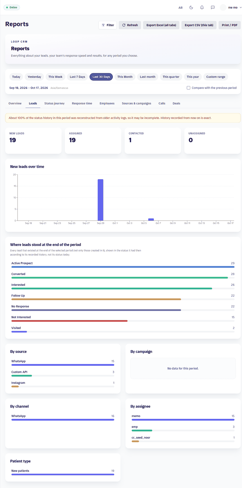

- **Contacted, Assigned, Unassigned:** how the new leads were handled.
- **Where leads stood at the end of the period:** every lead that existed when the period ended, placed in the status it had *then*, using each lead's recorded history. Change the end date and you can see how the pipeline looked on any day. This is **not** limited to leads created in the period.
- **By source, campaign, channel, assignee and type:** where the period's leads came from and who holds them.

### Status journey (every status a lead went through)

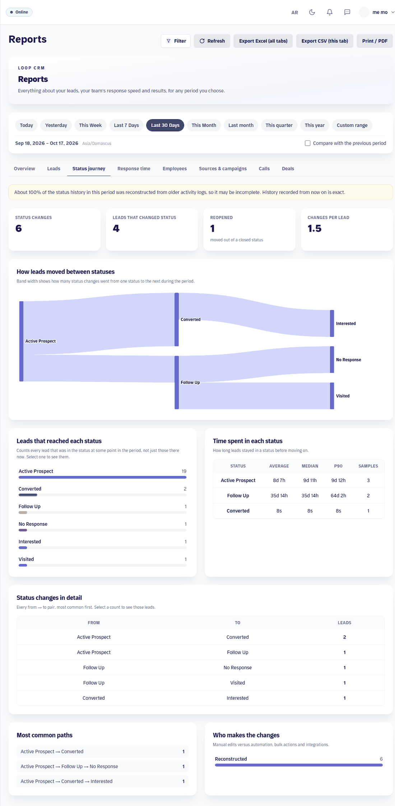

- **How leads moved between statuses:** a flow diagram. The wider the band, the more leads made that move. Moves *back* to an earlier status are not drawn (they cannot be shown in this kind of diagram), and a note tells you how many there were. They are still counted in the table.
- **Leads that reached each status:** how many leads were in each status at some point in the period, **including leads that have since moved on**. This is the "what did our leads go through" view. Click a bar to see them.
- **Time spent in each status:** how long leads stayed before moving on (average, median, and the slowest 10% marked P90).
- **Status changes in detail:** every from → to move, most common first. Click a number to see those leads.
- **Most common paths:** the typical routes, such as *Active Prospect → Follow Up → No Response*.
- **Who makes the changes:** manual edits versus automation, bulk actions and integrations.
- **Reopened:** leads moved out of a closed status.

### Response time (how fast employees respond)

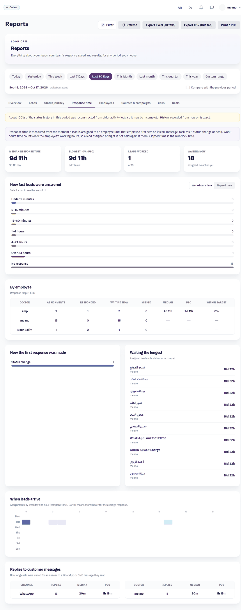

Read [section 7](#7-response-time-explained) first; it explains what is being measured.

- **Median, Slowest 10%, Leads worked, Waiting now:** the headline figures.
- **How fast leads were answered:** buckets from *Under 5 minutes* to *Over 24 hours* and *No response*. Switch between **Work-hours time** and **Elapsed time** at the top right. Click a bar for the leads.
- **By employee:** assignments, responded, waiting now, missed, median, slowest 10% and the share within target. *Missed* means the lead was taken away from them (reassigned) before they acted.
- **How the first response was made:** call, WhatsApp, task, visit, status change or deal.
- **Waiting the longest:** assigned leads nobody has acted on yet, oldest first. Click a name to open the lead.
- **When leads arrive:** a weekday-by-hour grid (company time). Darker means more assignments. Hover a square to see how long they took to answer.
- **Replies to customer messages:** how long customers waited for an answer to a WhatsApp or SMS they sent, by channel and by employee.

### Employees

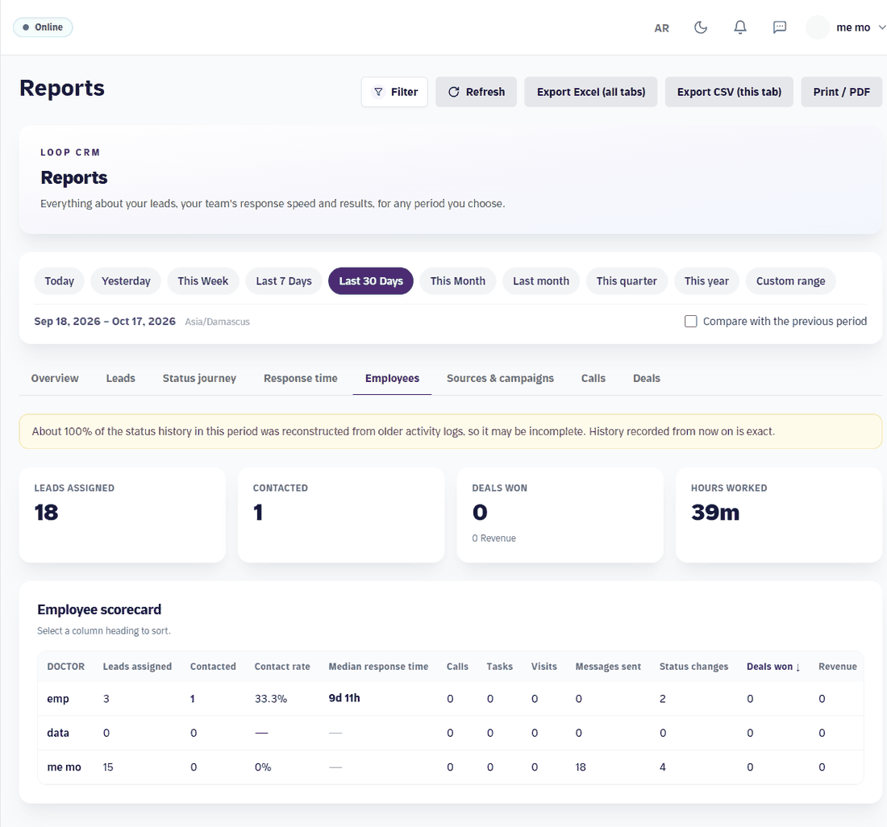

One scorecard row per person: leads assigned and contacted, contact rate, median response time, calls, tasks, visits, messages sent, status changes, deals won, revenue and hours worked (when working-hours tracking is switched on). Click a column heading to sort. Click the *Contacted* number to see those leads.

### Sources & campaigns

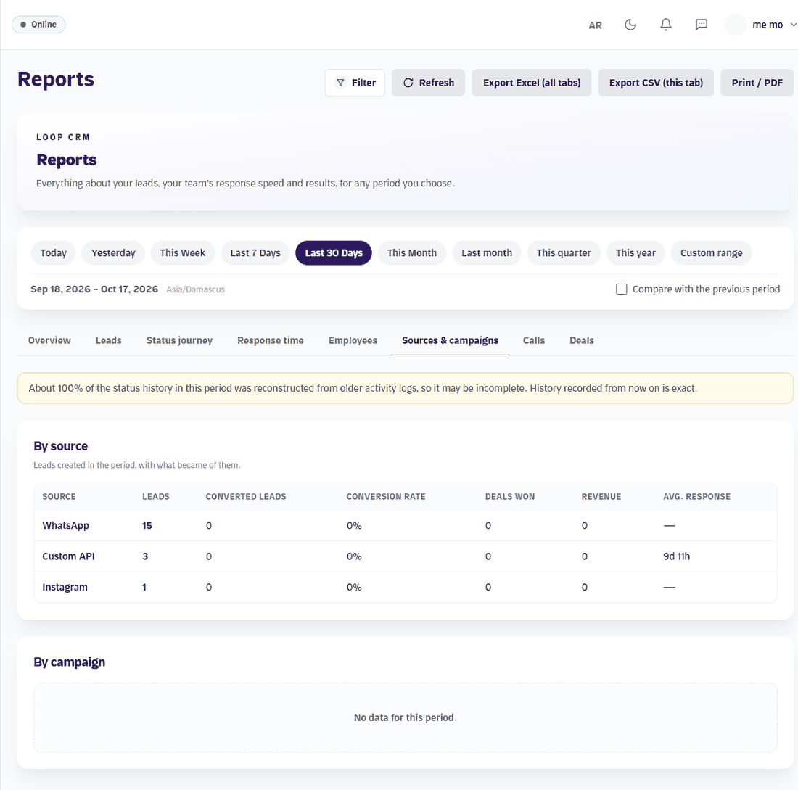

For leads created in the period, per source and per campaign: leads, converted leads, conversion rate, deals won, revenue, average response time and, for campaigns, budget and cost per lead.

### Calls

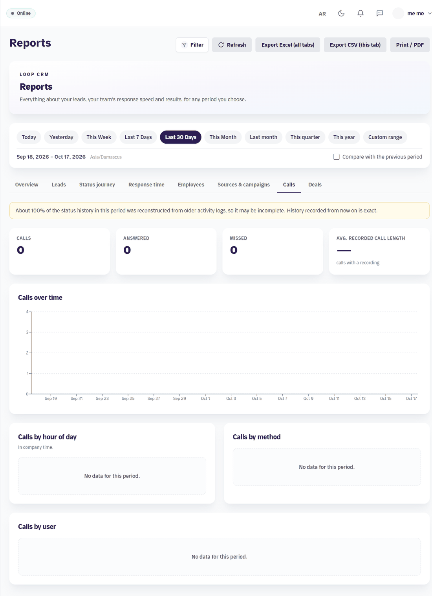

Calls over time, calls by hour of the day, and breakdowns by employee and by call method (answered, missed, unclassified).

### Deals

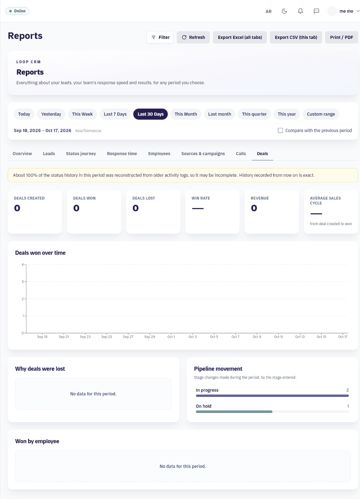

Deals created, won and lost, win rate, average sales cycle, revenue over time, why deals were lost, pipeline movement and wins by employee.

## 6. Drilling into the leads behind a number

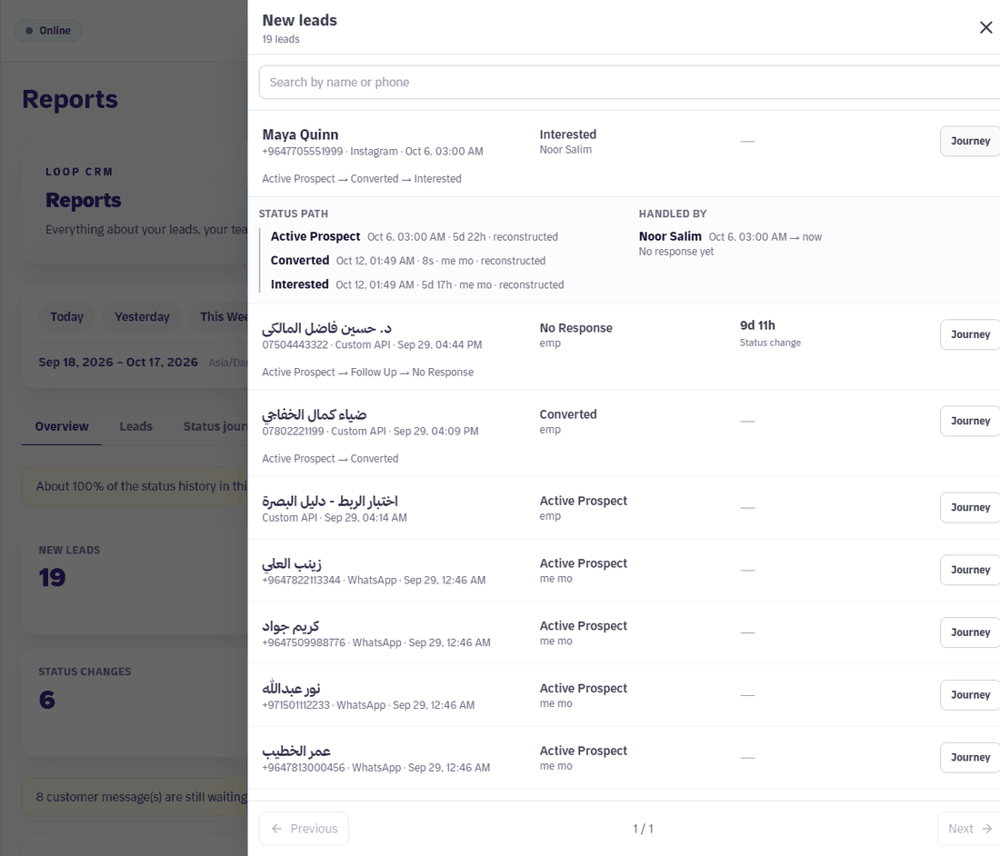

Underlined numbers and chart bars are clickable. A panel slides in with the **actual leads**:

- Name, phone, source, creation time, current status and who holds it.
- The **response time** (work-hours first, raw underneath) and how the first response was made.
- The **status path** the lead took in the period.
- **Search** by name or phone, and **Previous / Next** for long lists.

Press **Journey** on any lead for its complete story:

- **Status path:** each status, when it started, how long it lasted, who changed it and why. Entries rebuilt from older records are marked *reconstructed*.
- **Handled by:** each person who held the lead, from when to when, and their first response.

Click a lead's name to open the lead itself.

## 7. Response time explained

**What is measured.** From the moment a lead is **assigned** to an employee until that employee first **acts** on it. Acting means any of: a call, a WhatsApp or SMS message, a task, a visit, a status change, or a deal. Someone else acting on the lead does not count for them.

**Two ways to measure it.** Every response time is shown both ways:

| | Counts | Example: lead assigned 11:00 pm, first call 9:05 am next morning, shift 9–5 |
|---|---|---|
| **Work-hours time** (main figure) | Only the employee's working hours | **5 minutes** |
| **Elapsed time** (shown as "raw") | The plain clock | **10 hours 5 minutes** |

Work-hours time is the fair one for judging people; elapsed time is what the customer experienced. Use both.

**Whose hours?**

1. The employee's own shift, day off and time off, set on their profile.
2. If they have no shift, the **company business hours** (section 8).
3. If neither is set, there is nothing to subtract and both figures are the same.

**Response target.** The "within target" figure uses the target you set (15 minutes by default). It is measured on work-hours time. Leads that nobody has answered and that have already passed the target count against it.

**Median and "slowest 10%".** The median is the middle response: half were faster, half slower. It is not thrown off by one extreme case. *Slowest 10% (P90)* is the time that nine in ten responses beat.

## 8. One-time setup: business hours and target

Owners set this once under **Settings → Working hours tracking**, in the card **Business hours and response target**.

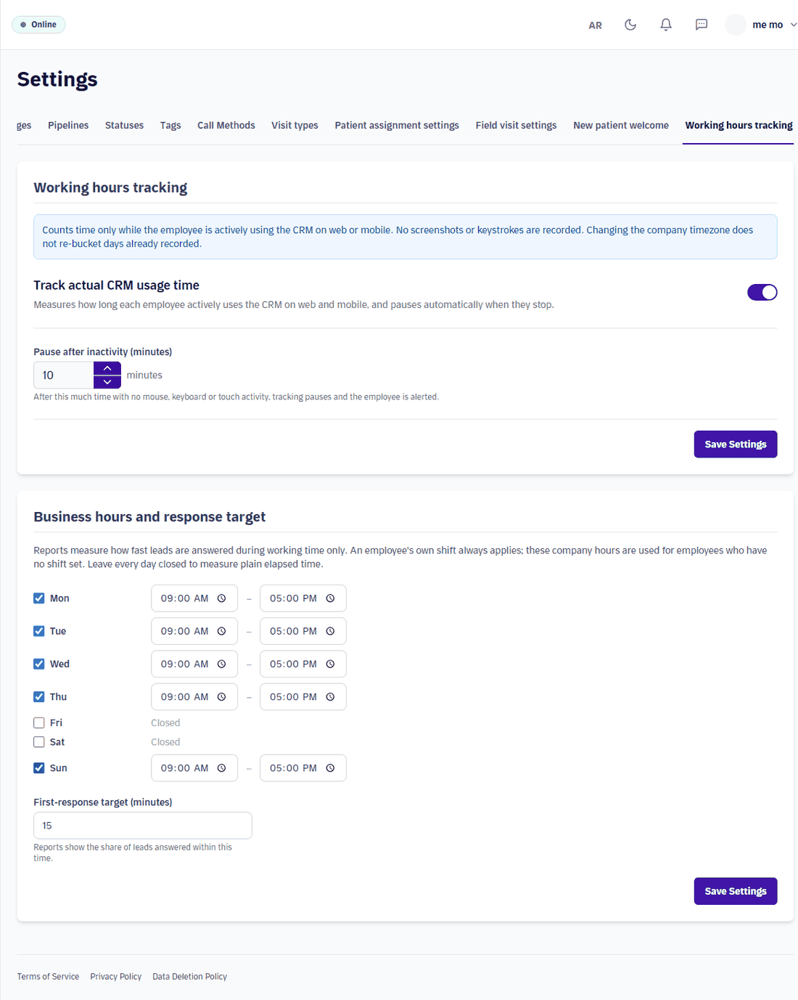

1. Tick each day you are open and set the opening and closing time. Leave a day unticked to mark it closed. Overnight hours (for example 10 pm to 6 am) are allowed.
2. Set the **First-response target** in minutes (1 to 10,080).
3. Press **Save Settings** in that card.

These hours apply to employees who have no shift of their own. For people with a shift, set it on their profile; that always takes priority.

> If you skip this step the reports still work. Response times then show plain clock time for everyone without a shift.

## 9. Exporting and printing

| Button | What you get |
|---|---|
| **Export Excel (all tabs)** | One workbook with a sheet for each table across all tabs, for the current period and filters |
| **Export CSV (this tab)** | The main table of the tab you are on |
| **Print / PDF** | The current tab as a clean printout. In the print window choose **Save as PDF** to make a file |

Notes:

- Excel and CSV hold **plain values, not formulas**. Durations are in whole **seconds**, shown in the column heading, so they sort and sum correctly. Percentages have one decimal.
- Excel files open right-to-left in Arabic.
- Printing hides the menus and runs across as many pages as needed.
- Excel does not repeat the "reconstructed history" notice from the screen; see section 11.

## 10. How the numbers are calculated

Everything is for the chosen period and filters, with dates in the company time zone.

| Number | How it is worked out |
|---|---|
| New leads | Leads created in the period |
| Assignments | Times a lead was assigned to someone in the period (a reassigned lead counts for each person) |
| Leads worked / Contacted | Assignments where that employee acted on the lead |
| Contact rate | Contacted ÷ assigned |
| Median / slowest 10% | Middle and 90th-percentile response among assignments that were acted on |
| Within target | Answered within target ÷ (answered + unanswered ones already past the target) |
| Waiting now | Assigned, no action yet, and still with that person |
| Missed | No action, and the lead was reassigned or unassigned |
| Status changes | Every status change in the period (a lead's first status is not a change) |
| Reached a status | Leads that entered that status at some point in the period |
| Time in status | How long leads stayed before the status changed |
| Calls | Calls logged in the period; answered/missed is worked out from the call method name |
| Deals won, Revenue | Deals won in the period and their total value |
| Conversion rate (Overview) | Deals won in the period ÷ new leads in the period |
| Converted leads (Sources) | New leads that have a won deal (won at any time) |
| Cost per lead | The campaign's whole budget ÷ its leads in the period |
| Hours worked | Measured time in the CRM, if working-hours tracking is on |

## 11. Reading history correctly

The system records every status change and assignment **from the day this feature went live**. For earlier leads it **reconstructs** history from older activity logs.

- Reconstructed history is **approximate**. If a status or employee was renamed, or an old action was never logged, it may be missing or slightly off.
- Whenever a period includes reconstructed data, a **yellow notice** at the top says what share of the status history is reconstructed.
- Anything recorded from now on is exact.
- Leads imported or changed in bulk by other means before go-live may show no history until the reconstruction is run (section 14).

Treat reconstructed periods as a good guide, and use periods after go-live when you need precision.

## 12. Arabic and right to left

Switch the language with the **AR / EN** button at the top. In Arabic the whole page mirrors: the sidebar moves to the right, tabs and charts read right to left, and dates and durations use Latin digits and Arabic units (**ي** day, **س** hour, **د** minute, **ث** second).

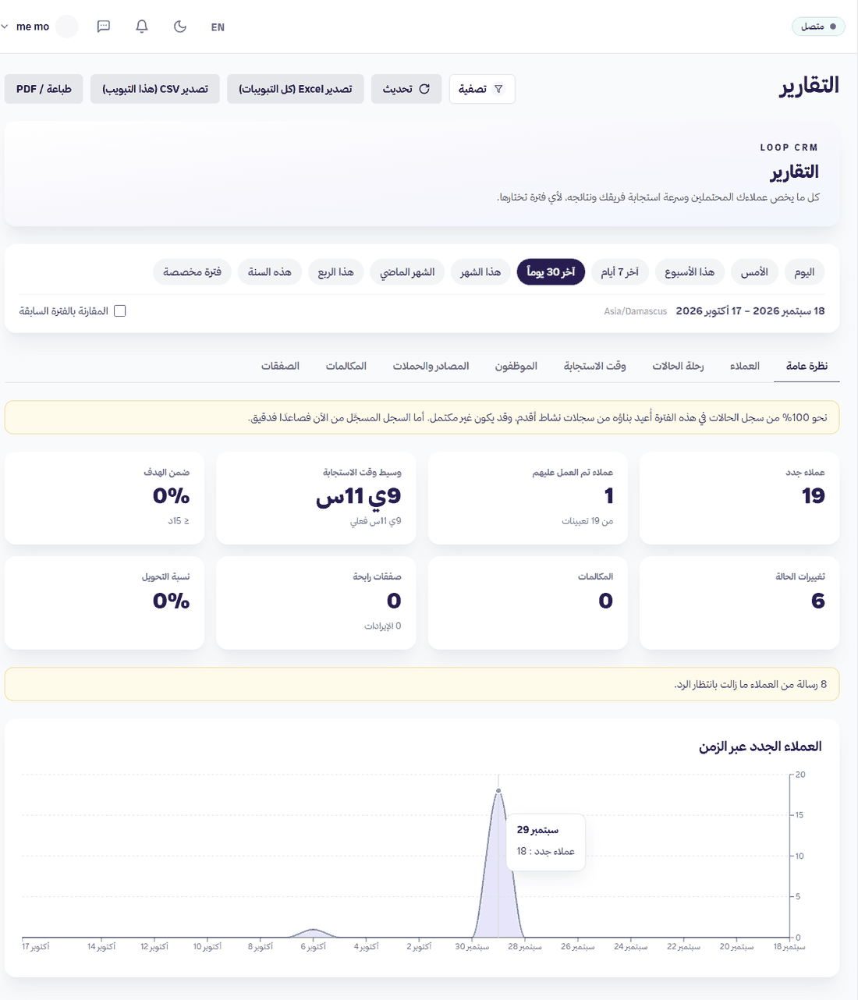

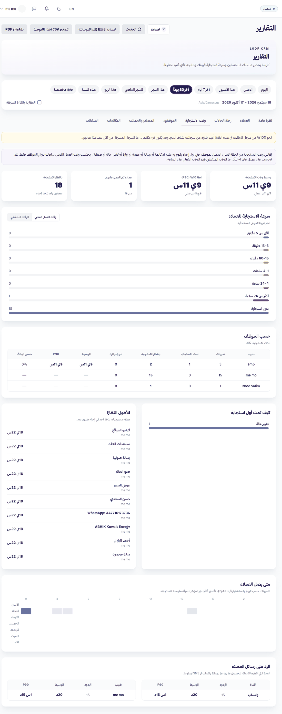

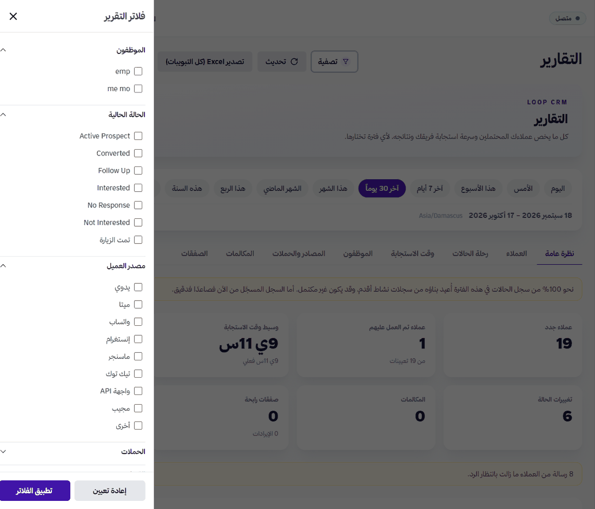

## 13. Troubleshooting

**Everything shows zero.**
There is no data in the period or filters. Try a wider preset and press **Reset** in Filters. If leads exist but history is empty, ask your administrator to run the history reconstruction (section 14).

**Response times look huge.**
Check whether it is **Work-hours time** or **Elapsed time**. Old leads that were never acted on, or whose history was reconstructed, can also inflate the median. Narrow the period to recent weeks.

**"Waiting now" is higher than I expect.**
It counts every assigned lead nobody has acted on yet, however old. Open **Waiting the longest** to see which ones.

**Median shows a dash.**
Nobody in the period has acted on a lead yet, so there is nothing to measure.

**The numbers differ from the Dashboard.**
The Dashboard uses fixed windows (7, 14 or 30 days) and current statuses. Reports use your exact period and recorded history. The differences are expected.

**An employee is missing from a table.**
The scorecard lists active owners, admins, supervisors, employees, reception staff and doctors. Deactivated users, data entry and call center accounts are not listed.

**Status names appear in English.**
Built-in starter names are translated in Arabic. Names you create yourself are shown exactly as typed.

## 14. For administrators

**Deploy order**

1. Run `python manage.py migrate` (adds the company business-hours fields and the new history tables).
2. Deploy the API and the web app.
3. Run once: `python manage.py rebuild_report_history`. It rebuilds the history of existing leads from older logs. It is safe to run again, never alters history recorded live, and accepts `--company <id>` and `--since YYYY-MM-DD`.

**What is recorded.** Three tables hold the history: status changes (with who, when, why and time in the previous status), assignment periods (with the first response and both response times), and replies to customer messages. Response times are saved at the moment of the response, so later changes to a shift do not rewrite the past.

**Developer note.** Code that changes a lead's status or assignee with `.update()` or `bulk_update` bypasses model signals and must call `reports.recorder` itself; otherwise the history misses that change.

**Known limits**

- Messenger and Instagram reply times are not tracked yet (WhatsApp and SMS are).
- There is no mobile Reports screen yet; the API is ready for one.
- Reconstructed history is best-effort (section 11).

**Technical reference.** The API lives under `/api/v1/reports/v2/` with sections `overview`, `leads`, `status-journey`, `response-time`, `employees`, `sources`, `calls`, `deals`, plus `lead-list/` and `leads/<id>/journey/`. All take `start`, `end`, optional `compare`, `granularity` and the filter lists.
